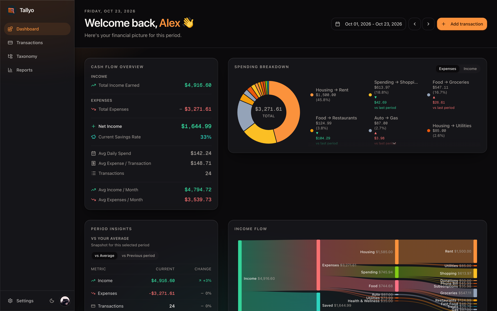
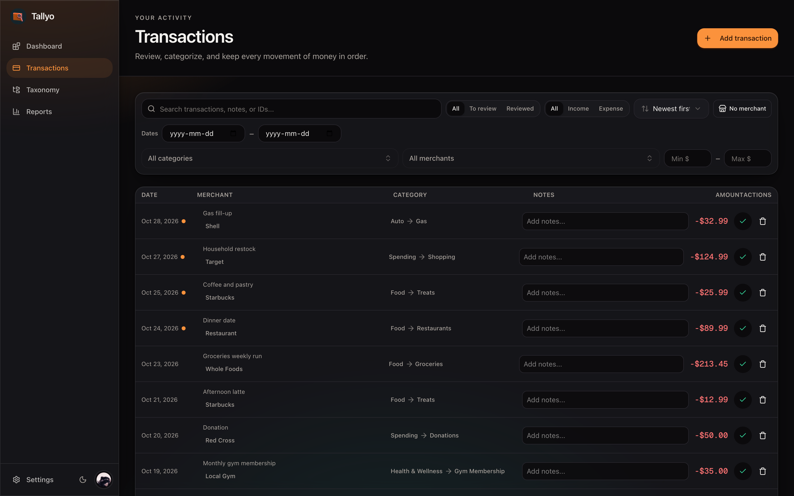
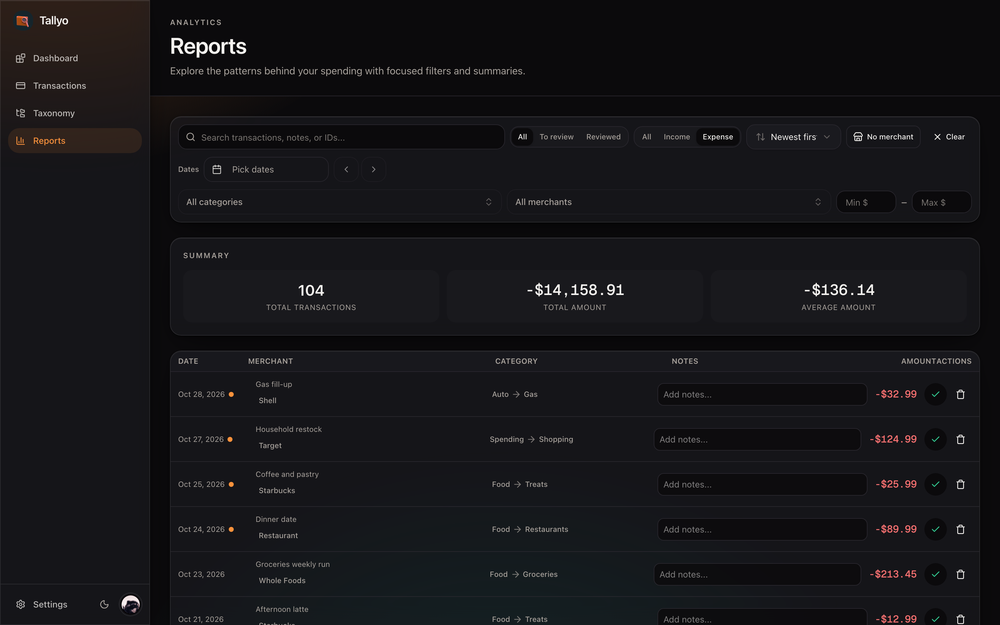
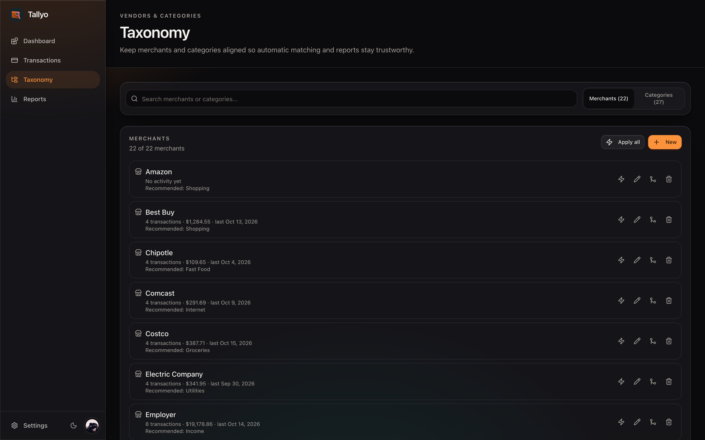

# Tallyo

Tallyo is a personal-finance app built around one workflow: import your transactions, normalize merchants and categories, then read the results on a dashboard and in reports.



## Features

- **Transactions**: create, edit, search, filter, review, split, and annotate, or import in bulk through the REST API.
- **Taxonomy**: merchants, categories, and keyword rules, with recommended categories you can apply in bulk.
- **Dashboard**: cash flow, spending breakdown, period-over-period insights, and an income-flow Sankey.
- **Reports**: filtered summaries and totals for any date range.
- **AI suggestions (optional)**: transactions that end up uncategorized can be queued for a category or merchant suggestion via OpenRouter. Suggestions are advisory metadata and are never applied automatically.
- **Auth**: Discord OAuth with server-side sessions.

## Stack

| Layer | Choice |
| --- | --- |
| Web | React 19, TanStack Router and Query, Tailwind CSS v4, Radix-based UI components |
| API | Hono, oRPC, Drizzle ORM |
| Data | PostgreSQL 16 |
| Tooling | Vite+ (`vp`) for dev, build, test, lint, and format; Vitest |

## Screenshots

|  |  |
| --- | --- |
|  |  |
|  |  |

## Getting started

Requires Node.js and Docker for the local database.

1. Install dependencies:

```bash
npm install
```

2. Start PostgreSQL:

```bash
npm run db:dev
```

3. Create the server env file and add your Discord OAuth credentials:

```bash
cp apps/server/.env.example apps/server/.env
```

`DISCORD_CLIENT_ID` and `DISCORD_CLIENT_SECRET` are required. Create a Discord application, add `http://localhost:3001/api/auth/callback/discord` as a redirect URI, and copy its client ID and secret into the file. `DATABASE_URL` already points at the compose database.

4. Apply the schema:

```bash
npm run db:push
```

5. Start both apps:

```bash
npm run dev
```

The web app runs at [http://localhost:3001](http://localhost:3001) and the API at [http://localhost:3000](http://localhost:3000).

Sign in with Discord, or skip OAuth in development by opening [http://localhost:3000/api/auth/dev-login](http://localhost:3000/api/auth/dev-login). It reuses the first user in the database, so seeded data is visible right away; add `?fresh=1` to create a separate test user instead.

## Sample data

```bash
npm run db:seed     # four months of transactions for the first user
npm run db:refresh  # three months, plus unreviewed transactions and merchant keywords
```

Both commands clear existing categories, merchants, and transactions. `db:refresh` also clears settings and the external API token.

## Scripts

| Command | What it does |
| --- | --- |
| `npm run dev` | Start web and server in parallel |
| `npm run dev:web` / `npm run dev:server` | Start one side only |
| `npm run build` | Production build |
| `npm run check` | Format, lint, and type-check with fixes |
| `npm run check-types` | Type-check both apps |
| `npm run test` | Run the Vitest suites |
| `npm run db:dev` / `npm run db:down` | Start or stop local PostgreSQL |
| `npm run db:push` | Push the Drizzle schema |
| `npm run db:generate` / `npm run db:migrate` | Create or apply migrations |
| `npm run db:seed` / `npm run db:refresh` | Load sample data |
| `npm run db:studio` | Open Drizzle Studio |

## Project structure

```
tallyo/
├── apps/
│   ├── web/      React SPA: routes, components, oRPC client
│   └── server/   Hono API, oRPC routers, Drizzle schema, migrations
├── examples/     Screenshots used in this README
├── compose.yml   Local PostgreSQL and production-style server container
└── vite.config.ts
```

## External API

The server exposes a bearer-token REST API under `/api` for importing transactions and reading merchants and categories. Generate a token in Settings, then send it with each request:

```bash
curl -X POST http://localhost:3000/api/transactions \
  -H "Authorization: Bearer $TALLYO_TOKEN" \
  -H "Content-Type: application/json" \
  -d '{"transactions":[{"amount":-1250,"date":"2026-10-20","transactionDetails":"WHOLEFDS","externalId":"demo-1"}]}'
```

The full reference is in [`apps/server/src/external-api-docs.md`](apps/server/src/external-api-docs.md) and is also served at `/api/docs`.
